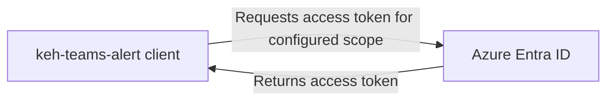
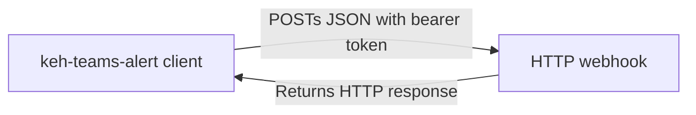

# KEH Teams Alert

`keh-teams-alert` is a small Python client for delivering JSON alerts to an HTTP webhook authenticated with an Azure Entra ID access token.

The package is intentionally transport-focused. It does not format messages, manage Teams channels, or store credentials. The calling application supplies the webhook URL and payload, while the client handles token acquisition and request authentication.

## Request flow

The request flow consists of two main steps: acquiring an access token from Azure Entra ID and sending the webhook request with the obtained token.

This flow happens when `post_to_webhook()` is called with a payload and the client has been configured with the necessary authentication details.

### 1. Acquire an access token



`get_token()` requests the token with `ClientSecretCredential`.

### 2. Send the webhook request



`post_to_webhook()` sends the supplied payload as JSON with these headers:

```http
Authorization: Bearer <access-token>
Content-Type: application/json
```

Additional headers can be supplied when the webhook requires them. They are merged into the default headers and can override a default value.

## Authentication configuration

Create an Entra ID application (instructions for this can be found in `README.md`). The application needs:

- Tenant ID
- Client ID
- Client secret
- Scope, normally in the form `https://management.azure.com/.default` for this integration

Pass these values to `TeamsAlertClient` creating an instance of the client.

How these secrets are obtained and managed is the responsibility of the calling application. They should be stored securely and never hard-coded in source code or included in alert payloads.

## Payload contract

The client accepts any JSON-serialisable Python dictionary. Payload validation belongs to the webhook integration, so the exact fields depend on the receiving endpoint. For the KEH alert convention, a payload contains a `channel` and `message`:

```python
{
 "channel": "alerts",
 "message": "A job completed successfully.",
}
```

The client returns the `requests.Response` from the webhook. This allows callers to inspect response headers or content after a successful request. `raise_for_status()` is called before the response is returned, so non-success HTTP responses raise `requests.HTTPError`.

## Error behaviour

Authentication and token-network failures are normalised to `RuntimeError`:

| Condition                                            | Exception            | Meaning                                                |
|------------------------------------------------------|----------------------|--------------------------------------------------------|
| Invalid credentials, scope, or consent               | `RuntimeError`       | Entra ID rejected token acquisition.                   |
| Network, DNS, or TLS failure while acquiring a token | `RuntimeError`       | The Entra ID endpoint could not be reached.            |
| Non-success webhook response                         | `requests.HTTPError` | The webhook rejected or could not process the request. |

The original Azure exception is retained as the cause of the `RuntimeError`, so applications can log or inspect it when troubleshooting. The client does not retry requests; retry policy should be owned by the calling application because it depends on whether sending the alert is idempotent.

## API reference

::: keh_teams_alert.TeamsAlertClient
options:
show_source: false

`TeamsAlertClient` is the public client used to acquire an Entra ID token and post an authenticated JSON payload to a webhook.

## Development notes

The automated tests mock both Azure token acquisition and the webhook request, so they do not send messages or require cloud credentials.

Use `tests/manual_testing.py` only for an intentional end-to-end check with locally provided environment variables. The script expects `TEAMS_TENANT_ID`, `TEAMS_CLIENT_ID`, `TEAMS_CLIENT_SECRET`, `TEAMS_WEBHOOK_URL`, and `TEAMS_CHANNEL` as per its docstring.

Before changing the client, preserve the following boundaries:

- Credentials are provided by the caller and are not read from a fixed environment or file by the library.
- Token acquisition happens immediately before a webhook request.
- HTTP status failures are surfaced to the caller rather than converted to a success result.
